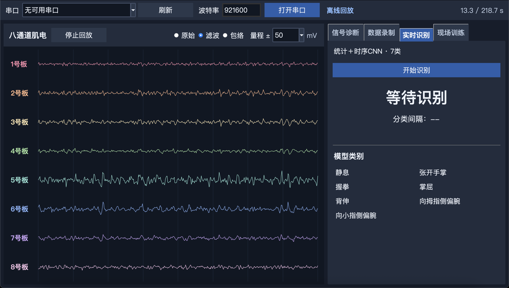
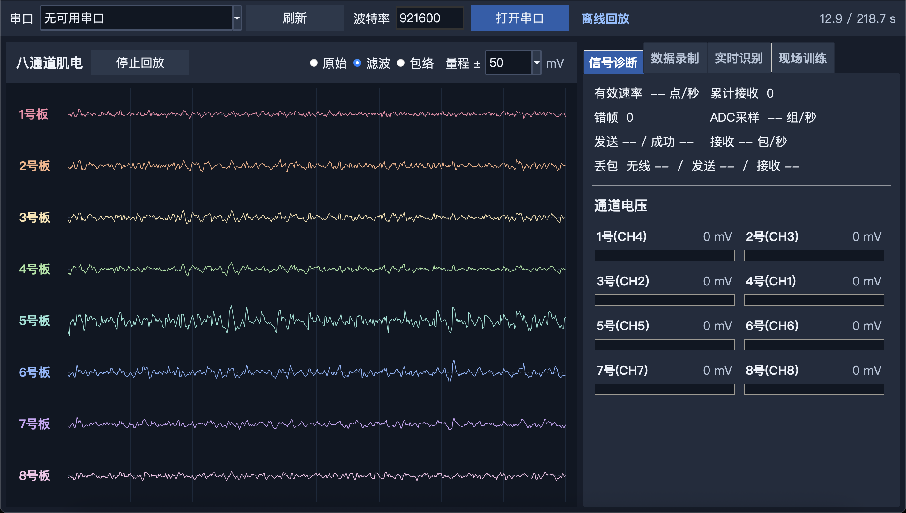
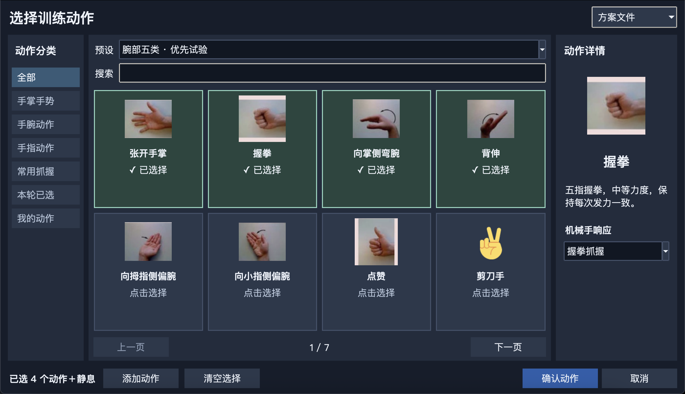

# 双板协同可定制肌电仿生手

**八通道表面肌电 × 双 FPGA 协同推理与控制 · Dual-Board sEMG Bionic Hand**


用前臂肌肉电信号直接驱动五指机械手：A 板在 FPGA 上用**纯 RTL** 完成信号处理与时序 CNN 定点推理，B 板负责动作回放、舵机闭环监测与 1080p 显示，两板通过串口与握手邮箱协同。整机脱离电脑可独立运行，支持现场采集与个性化参数生成。



## 关键指标

| 指标 | 结果 |
| --- | --- |
| 识别准确率（8 类手势，留出集） | **97.01%** |
| 定点推理与浮点输出一致率 | **99.67%** |
| 单窗推理时延 | **1.32 ms**（31,584 周期 @ 24 MHz） |
| INT8 乘加阵列 | 32 路（16 个 DSP 实现） |
| A 板 LUT 占用 | 92.41%（资源打满仍稳定） |
| 显示输出 | 1920×1080 @ 60 Hz VGA |
| 无线链路 | ESP32-S3 / C3，8 通道 sEMG |

## 系统架构

```
  前臂 8× 表面肌电电极
        │
   [手环 AFE] ── 无线 ──▶ ESP32-S3 / C3
                              │ 串口 / 并行数据链路
                 ┌────────────┴─────────────┐
          A 板（识别）                  B 板（执行 / 显示）
          安路 EG4S20                   安路 EG4S20
     滤波 → 统计特征 → 时序 CNN     动作表回放、拖动示教、
     → 分类（纯 RTL，INT8 定点）     舵机位置/负载/温度监测、
                                     异常与超时保护、VGA 显示
                 └──────── 手势结果 ─────────┘
```

## 实现要点

**不依赖 CPU 软核。** 滤波、特征、卷积、分类、通信调度全部是 RTL，时延确定，没有调度抖动。

- **滤波复用乘法器**：多级滤波共用同一组乘法器分时复用，省下大量 DSP。
- **滑动窗口增量统计**：特征不整窗重算，只做增量更新，运算量与窗口长度解耦。
- **共享乘加阵列**：三层卷积共享 32 路 INT8 乘加单元，配合 8 个权重存储体与激活缓存复用，把片上存储压进可用范围。
- **定点链路**：浮点训练 → INT8 量化 → RTL 推理，与浮点输出一致率 99.67%，保证"训练得好"能落到"板子上跑得对"。
- **前端没有陷波器**：硬件采集链路缺工频抑制，改在软件侧做 50 Hz 抑制与基线漂移校正，用算法补硬件的短板。

## 界面

| 实时识别 | 信号诊断 |
| --- | --- |
|  |  |



## 目录结构

```
fpga/A_recognition     识别板：RTL 源码、约束、可部署 bitstream
fpga/B_execution       执行/显示板：RTL 源码、显示与舵机控制、bitstream
pc/                    PC 端工具（Python）：数据采集、训练、定点导出、验证
wireless/              ESP32 无线固件（PlatformIO 工程）
models/                定点参数与部署清单（parameters.bin 等）
docs/                  技术文档、构建说明、版本与打包校验记录
tools/                 离线测试与打包校验脚本
```

## 复现

**PC 端（数据 → 模型 → 定点参数）**

```bash
cd pc
pip install -r requirements.txt
python app/scripts/pc_gesture_tasks_verify.py --help   # 训练/验证/导出入口
```

**无线固件（ESP32）**

```bash
cd wireless
pio run -t upload        # platformio.ini 已配置 S3 / C3 两个环境
```

**FPGA（安路 TD）**

分别用 TD 打开 `fpga/A_recognition` 与 `fpga/B_execution` 的工程，综合后下载对应 `.bit`。板级引脚与时钟约束见各目录下的说明与 `.tcl`。

## 技术文档

完整的方案、实验与验证记录见 **[docs/技术文档.pdf](docs/技术文档.pdf)**（含定点误差分析、资源占用与现场测试数据）。

## 关于本仓库

- 本仓库是竞赛作品的代码整理版，**已剔除**综合网表、布局布线数据库（`.db`）、原始采集数据与中间产物（合计约 250 MB），保留可读源码、约束、部署 bitstream、文档与验证记录。
- 硬件采集板与无线模组由队友完成；`wireless/` 为协同调试版本。
- 代码仅供学习与复现参考。

## 作者

**刘广腾** · 大连海事大学 测控技术与仪器 · 2028 届
负责：算法（滤波 / 特征 / 时序 CNN / 定点量化）、FPGA RTL 实现、PC 端训练与部署工具链
